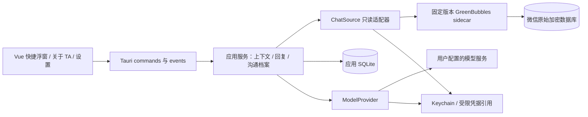
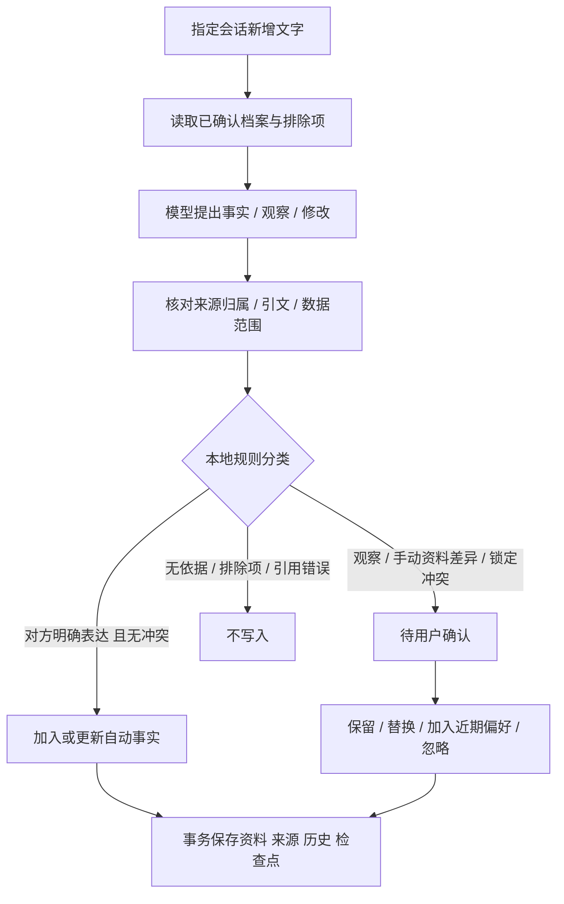

# 微信回复助手技术架构

版本：v1.0；日期：2026-11-16。本文是拟实施架构，不代表这些模块已经存在。产品边界以 [PRD.md](PRD.md) 为准，开发顺序见 [PLAN.md](PLAN.md)。

当前已实现 v0.1 体验版子集，实际状态见 [DEV_STATUS.md](DEV_STATUS.md)。体验版增加显式 demo 数据源，共用 shared/demo-workspace.json；只持久化资料，不持久化示例聊天。当前使用 load_workspace/profile_action 等聚合命令，模型生成采用可取消的 invoke Promise；第 6 节完整业务命令与事件接口仍是 MVP 目标，不宣称已经全部落地。

## 1. 技术选型

本轮新增的实现模块：`GroupContext` 负责群消息选择，`ConversationSummary` 保持主面板摘要，`ChatHistoryPanel` 提供独立记录视图，`BackgroundField` 管理背景开关，`ToneSettings`/`ToneEditor` 负责设置中的模板管理，`SyncSettings` 和 `useAutoSync` 负责同步配置与唯一计时器。HTTP 客户端现在由 AppState 创建并复用，测试连接和回复请求共用连接池，保留原有 45 秒超时和请求取消；尚无真实 API 延迟或长时间内存测量。

当前群聊仅来自虚构 fixture，不写入 contacts/conversations，也不建立 profiles。服务端验证选中消息及回复对象必须属于该群，提示词带独立成员身份和引用 ID，并强制不带画像。真实群读取需要后续扩展源契约和会话存储，不能将示例 UI 当作真实群接入证据。

| 层次 | 选择 | 选择理由与边界 |
| --- | --- | --- |
| 桌面容器 | Tauri 2 + Rust | 支持 Web 前端与原生能力；窗口、快捷键、文件和进程集中在原生侧 |
| 前端 | Vue 3 + TypeScript + Vite | 使用单文件组件和 Composition API；适合小浮窗和档案视图；本项目不同时引入 React |
| 状态 | Pinia + 组件局部状态 | 只管理联系人、任务和展示状态；不持有原生凭据 |
| 样式 | 模块化 CSS / Vue scoped CSS | 沿用轻量 macOS 风格，不为小浮窗引入整套后台组件库 |
| 原生服务 | Rust、Tokio、serde、reqwest | 异步查询/网络调用、明确 DTO、模型输出解析 |
| 微信读取 | 固定 GreenBubbles v0.10.0 查询二进制，经 Rust 适配器调用 | 复用已验证能力，不从头重写微信数据库解析；只允许选定的查询命令 |
| 本地数据 | SQLite + rusqlite（bundled）+ SQL 迁移 | 保存联系人映射、档案、来源、变更与配置；不复制微信全量消息库 |
| 凭据 | 模型 Key 使用 macOS Keychain；微信查询使用已有受限凭据文件 | 不把两类凭据混用；微信凭据迁移到 Keychain 不在 MVP 内 |
| 测试 | Vitest、Vue Test Utils、Rust 测试；Playwright 浏览器态交互 | 原生窗口/权限/打包另做 macOS 实机验收，不以浏览器模拟替代 |
| 工具链 | Node.js 24、npm workspaces、Rust stable | 初始化时锁定具体版本，提交 package-lock.json、Cargo.lock 和工具链配置 |

Tauri 官方提供 sidecar 和全局快捷键机制；打包外部程序需对应目标架构的文件，并处理签名。能力声明用于限制 WebView 暴露的权限，但不能替代 Rust 自身对业务输入的检查。[外部二进制](https://v2.tauri.app/develop/sidecar/)、[全局快捷键](https://v2.tauri.app/plugin/global-shortcut/)、[Capabilities](https://v2.tauri.app/security/capabilities/)

Vue 的 Vite 转译不等于 TypeScript 类型检查，构建检查需单列 `vue-tsc`。[Vue TypeScript 文档](https://vuejs.org/guide/typescript/overview.html)

### 1.1 不把 MCP 作为内部必经层

桌面端直接调用自己的 Rust 应用服务，应用服务通过 `ChatSource` 访问查询适配器。无需再启动 Python MCP 服务、HTTP 后端或独立本地网络端口。

未来若要给其他 AI 客户端使用，可在应用服务外增加 MCP 只读适配层；不能让界面绑定某个 MCP 工具名。现有 Python/AX 验证代码保留为历史验证资料，不自动成为正式运行依赖。

### 1.2 上游复用与定制边界

- MVP 使用经校验的上游查询二进制；固定 v0.10.0、来源、SHA-256 与许可证，升级前重新验收。
- 查询输出归一化、上下文选择、回复策略、沟通档案和页面由本项目实现。
- 不直接 fork 整个上游；只有确认存在必要缺口时再评估源码定制，不把快照、发送、全量个人记忆工作流一并引入。
- GreenBubbles 的 MIT 许可证及其附带 NOTICE/第三方声明在分发时保留。[上游项目](https://github.com/bojieli/greenbubbles)
- 上游当前文档的一般采集流程涉及管理员权限和微信改签；本机验证使用已有条件且未改签。不能把本机成功等同于所有 Mac 的无侵入安装流程。MVP 优先接入用户已配置的数据源，不自动执行采集或环境修改。

## 2. 系统结构



图中所有微信数据访问均为读取。SQLite 与微信数据库是不同数据源，连接、路径和生命周期必须分开。

### 2.1 进程和权限

- 一个 Tauri 应用进程及 WebView；查询时按需启动 GreenBubbles 子进程，查询完成退出。
- 子进程路径由应用配置/打包资源确定并校验，不接受前端传入任意可执行路径、shell 字符串或原始 SQL。
- 通过参数数组传递固定命令和稳定会话 ID，不使用 `sh -c`。凭据不放进 argv、环境输出或日志。
- 前端不拥有 shell、通用文件读取、直接数据库访问权限；仅调用已注册的业务命令。
- 在应用 manifest 与窗口能力中明确限制自定义命令；Tauri 注册命令的默认可达性需要显式检查，不能只写一份 capabilities 文件便认为所有命令已隔离。
- 源库访问范围按实际 macOS 权限要求做诊断；不把辅助功能或屏幕录制设为数据库读取的固定前置条件。
- 浮窗隐藏即停止刷新与自动分析触发；MVP 不设常驻扫描进程。

## 3. 模块职责

| 模块 | 职责 | 不承担 |
| --- | --- | --- |
| frontend/features/reply | 对象、任务、语气、背景、候选、草稿 | 数据库读取、密钥处理、档案写入判断 |
| frontend/features/profile | 资料/观察/历史、手动编辑与核对 | 在前端直接把模型结论写成事实 |
| frontend/features/settings | 模型设置、读取诊断、快捷键、数据清理 | 显示已有 Key 明文、自动采集微信密钥 |
| frontend/bridge | invoke/event 的统一类型封装 | 散布后端命令字符串和业务逻辑 |
| commands | DTO 校验、调用应用服务、窗口来源检查 | 拼接提示词、拼 SQL 或执行任意 CLI |
| application/context | 解析消息、上下文截断、发送方与最后发言判断 | 推测不可读附件内容 |
| application/reply | 冻结上下文快照、调用模型、取消及结果分发 | 自动发送或把“已复制”记为“已发送” |
| application/profile | 提议分类、证据校验、排除/锁定/生效规则、历史 | 无依据的性格诊断、静默覆盖手动资料 |
| domain | 消息、任务、档案实体和纯规则 | Tauri、网络、磁盘等具体实现 |
| infrastructure/chat | GreenBubbles 版本适配、分页、JSON 归一化、错误映射 | 提示词、画像生成、微信写入 |
| infrastructure/model | 服务商协议、超时、响应解析、用量统计 | 决定是否覆盖档案 |
| infrastructure/storage | SQLite 仓储、事务与迁移 | 复用微信连接做写操作 |
| infrastructure/platform | 窗口、快捷键、剪贴板、Keychain | 业务推断 |

### 3.1 目标目录（部分模块已实现，详见 DEV_STATUS）

```text
wechat-reply-assistant/
├── AGENTS.md
├── docs/{PRD,ARCHITECTURE,DB_DESIGN,PLAN}.md
├── package.json                 # npm workspace 与统一命令
├── package-lock.json
├── rust-toolchain.toml
├── frontend/
│   ├── package.json
│   ├── vite.config.ts
│   ├── tsconfig.json
│   ├── src/
│   │   ├── App.vue              # 只负责组装
│   │   ├── features/{reply,profile,settings}/
│   │   ├── components/          # 通用小组件
│   │   ├── bridge/              # 原生命令与事件契约
│   │   ├── stores/
│   │   ├── types/
│   │   └── styles/
│   └── tests/{unit,e2e}/
├── src-tauri/
│   ├── Cargo.toml
│   ├── Cargo.lock
│   ├── tauri.conf.json
│   ├── capabilities/
│   ├── permissions/
│   ├── binaries/                # 按目标架构准备的已校验查询程序
│   ├── migrations/
│   ├── src/{commands,application,domain,infrastructure}/
│   └── tests/fixtures/          # 仅虚构或脱敏契约样本
├── scripts/                    # 构建与依赖校验脚本
└── 原有 Python、验证文档和本机报告 # 保留；不混入正式桌面构建
```

## 4. 数据源契约

以下类型为项目内部契约，不是 GreenBubbles 原始 JSON 字段。完整格式须用固定二进制实际输出建立契约样本，不能把默认 JSONL、`--json` 对象和历史示例混为一谈。

```typescript
type MessageDirection = 'self' | 'other' | 'unknown';
type MessageKind = 'text' | 'image' | 'video' | 'voice' | 'file' | 'system' | 'unknown';

interface ChatMessage {
  id: string;                 // 上游 opaque message ID，不能按数字解析
  conversationId: string;
  senderId: string | null;
  direction: MessageDirection;
  sentAtMs: number | null;     // UTC epoch ms；无法确定时保留 null
  sourceOrder: number;        // 本次读取的稳定相对顺序，不冒充全局序列
  kind: MessageKind;
  text: string | null;
}

interface ContextSnapshot {
  id: string;                 // 原生内存快照 ID，非数据库主键
  accountId: string;
  conversationId: string;
  source: 'wechat_db' | 'manual';
  readAtMs: number;
  messages: ChatMessage[];    // 归一化后按聊天顺序展示
  lastSender: MessageDirection;
  warnings: string[];
  truncated: boolean;
  coverage: 'selected_window' | 'partial';
}
```

`ChatSource` 的最小操作为 `health`、`listConversations`、`readRecent`、`readSince`、`readMessage`。手动输入形成另一种内存快照，不能伪装为数据库来源，也不能自动更新持久档案。

### 4.1 查询实现约束

1. 初次只使用白名单中的版本检查、数据源状态、会话列表/查找、消息列表、指定消息读取命令；精确语法以固定二进制 `--help` 为准。
2. 对账号绑定显式 query profile 与 source root，避免上游“最近使用账号”的自动选择导致串号；应用不覆盖用户原有默认 profile。
3. 默认读最近 50 条，最多向 UI 提供 200 条；沿上游分页查询，处理 hasMore、nextCursor 和缺失标记。上游 newest 顺序归一化为聊天展示顺序；同一时间不按消息 ID 字典序重排。
4. 增量分析采用 since 时间重叠窗口加 message ID 去重，沿 cursor 读到分析边界；cursor 只用于同一数据源/会话/过滤条件，不能跨次当全局增量序列。
5. 单次增量最多处理 200 条，更多则分批保留进度；必须连续处理完一个边界才能推进分析检查点。中断或部分解码失败不宣称完整，不越过未处理缺口。
6. 本人标记不可用、消息方向不明、输出结构不兼容分别报错或明确降级；不靠昵称兜底猜本人。
7. 附件只保留类型，丢弃不需要的媒体路径，不启动附件物化。需在接入任务中确认所选上游命令是否仍会产生媒体缓存；若默认存在，必须禁用或阻断该副作用后才能进入 MVP。
8. 查询超时默认 10 秒；取消/超时终止本次子进程，保留可重试状态；仅保留退出码、错误分类和耗时，不写原始 stdout/stderr 到日志。

## 5. 业务流程

### 5.1 回复生成

1. 用户选定会话后创建内存快照，UI 显示读取范围与时间。
2. 生成时冻结快照、任务、语气、本次背景和选中的已生效档案。草稿和正文不默认入库。
3. 按输入预算从旧到新截断，保留最后发言与必要提示；原文是数据，不作为系统指令。
4. 最后发言为己方且任务为 reply 时返回 `ACTION_REQUIRED`，由用户改选任务。
5. 确认模型处理范围后请求服务，要求结构化返回 3 条候选；本地校验数量、非空和字段类型。暂不依赖服务商专有 JSON Schema 或流式能力。
6. UI 根据 requestId 和 conversationId 接收结果。切换联系人会取消旧请求；晚到结果丢弃，避免常见的切换串会话问题。
7. 用户编辑并调用原生剪贴板复制。系统只知道“已复制”，没有发送回执。

### 5.2 档案更新



- 开启条件与触发阈值见 PRD F-08；档案任务不阻塞回复任务。
- 同一联系人一次只有一个分析任务；写入时检查读取的资料 revision。用户在分析期间修改资料时重新核对，不把旧分析结果覆盖到新资料上。使用本地事务即可，不引入分布式锁。
- 人工来源的内容即使未锁定仍有优先权；`locked` 同时允许保护自动来源的资料。
- 近期项具有 expires_at_ms；已过期内容保留历史但不参与生成。模型不能确定到期时间时形成待确认提议。
- 排除按具体 subject_key 生效，例如 `communication.emoji`；不能因为拒绝一条偏好就屏蔽整类“明确偏好”。
- AI 返回真实引文也可能解释错误，因此支持修改已采纳资料、删除与“不再记录”；不显示没有可靠标定的置信分数。

## 6. 前后端接口

### 6.1 通用约定

- UI 统一通过 `frontend/src/bridge` 调用；命令参数为 `{ input: ... }`，DTO 用 camelCase，Rust 内部用 snake_case。
- 普通命令返回 `Result<T, AppError>`，序列化错误为 `{ code, message, retryable, requestId? }`。不得返回密钥、源文件私有正文或原始错误堆栈。
- 所有档案、会话读写在 Rust 内检查所属 account/contact，不能相信 UI 传来的显示名称。
- 时间均为 UTC epoch ms；列表带 limit/cursor；普通 limit 默认 50、上限 200。

| 命令 | 主要输入 | 返回/作用 |
| --- | --- | --- |
| get_app_status | 无 | 工具版本、源库可用状态、账号绑定、模型配置状态；不读取正文 |
| bind_account | queryProfileName | 验证并绑定明确数据源，返回 AccountSummary；不传密钥值 |
| list_conversations | accountId, query?, cursor?, limit? | 私聊摘要列表与下一页，不自动选中重名对象 |
| load_context | conversationId, limit? | ContextSnapshot；更新当前原生内存快照 |
| import_context | conversationId, transcript, selfLabel | 手动片段快照；不修改数据库档案游标 |
| start_reply | requestId, snapshotId, task, tone, customTone?, background?, useProfile, providerId | `{requestId}`，确认接受请求，实际结果由事件返回 |
| cancel_reply | requestId | 取消指定本机请求，不影响其他联系人资料 |
| copy_reply | text | 原生复制成功状态；不访问微信输入框 |
| get_profile | contactId, tab, cursor?, limit? | 资料、待确认提议、历史及版本，按页返回 |
| save_profile_item | contactId, itemId?, expectedRevision?, category, subjectKey?, content, locked, validFromMs?, expiresAtMs? | 手动保存后的 ProfileItem；新手动项默认 locked=true |
| delete_profile_item | itemId, expectedRevision, excludeFuture | 删除相关内容；可同时新增排除项 |
| decide_profile_proposal | proposalId, action, expectedRevision?, expiresAtMs? | 保留、采纳替换、加入近期项或忽略后的结果 |
| list_profile_exclusions | contactId | 已排除的具体事项，供解除 |
| remove_profile_exclusion | exclusionId | 允许后续重新提议，不自动恢复旧正文 |
| set_profile_auto_update | contactId, enabled | 保存联系人自动更新开关；首次开启需模型处理确认 |
| start_profile_update | requestId, conversationId, mode: recent/incremental | `{requestId}`；recent 只分析当前窗口并标记范围 |
| cancel_profile_update | requestId | 取消本次档案分析；不推进检查点、不应用未提交的提议 |
| get_settings | 无 | 配置摘要与 Key 是否存在，永不返回已有 Key |
| save_provider | id?, name, baseUrl, model, apiKey? | Keychain 保存 Key，SQLite 保存引用；空值不默认清除已有 Key |
| remove_provider | providerId | 删除配置、对应 Keychain 项和处理范围确认；清理默认引用 |
| test_provider | providerId | 使用固定无聊天测试文本检查连通及基本输出协议 |
| confirm_model_processing | providerId, scopes: reply/profile | 记录用户确认及端点/范围版本；更换端点后失效 |
| save_app_settings | shortcut?, pinDefault? | 白名单设置，不接收任意 JSON 路径写入 |
| clear_contact_data | contactId | 清理该联系人的资料、提议、来源、历史与排除；关闭自动更新 |

`decide_profile_proposal.action` 为 `keep_existing | accept | accept_as_recent | ignore`。新增观察的 accept 变为用户确认资料；冲突的 accept 替换目标，仍记录用户确认与来源。`accept_as_recent` 必须有用户确认的到期时间。

### 6.2 异步事件

| 事件 | 载荷 |
| --- | --- |
| reply-progress | requestId, conversationId, phase: preparing/requesting |
| reply-completed | requestId, conversationId, candidates: [{id,text}], warnings, usage? |
| reply-failed | requestId, conversationId, error |
| reply-cancelled | requestId, conversationId |
| profile-update-completed | requestId, contactId, addedCount, pendingCount, revision, warnings |
| profile-update-failed | requestId, contactId, error |
| source-status-changed | accountId, status, checkedAtMs；不带聊天正文 |

完成和取消只产生一个终态。UI 在 invoke 前生成 requestId 并注册监听，再把相同 ID 传给启动命令；原生侧校验其格式及是否重复。这样即使请求快速返回，也能对应到正确的界面任务。事件丢失时显示“结果未知，可重试”，不把它记成成功。

### 6.3 错误代码

`SOURCE_NOT_CONFIGURED`、`SOURCE_UNAVAILABLE`、`CREDENTIAL_UNAVAILABLE`、`SOURCE_INCOMPATIBLE`、`IDENTITY_UNKNOWN`、`CONVERSATION_AMBIGUOUS`、`CONTEXT_PARTIAL`、`ACTION_REQUIRED`、`MODEL_NOT_CONFIGURED`、`MODEL_CONSENT_REQUIRED`、`MODEL_TIMEOUT`、`MODEL_INVALID_RESPONSE`、`CANCELLED`、`PROFILE_VERSION_CONFLICT`、`VALIDATION_ERROR`、`STORAGE_ERROR`。

部分消息可用时 `CONTEXT_PARTIAL` 可以作为快照 warning 返回，但不能静默跳过。身份不明和无可用文字时需阻止对应自动任务。

## 7. 模型适配与输入控制

- `ModelProvider.generateReplies` 与 `extractProfileProposals` 分开，均接收本地构造的最小数据；AI 没有 Tauri 工具调用或数据库写权限。
- 初期实现一个配置式 HTTP 适配器，拟支持 Chat Completions 风格协议；具体服务商、认证方式、响应结构在 M0 试验中确认，不宣称所有兼容服务都能直接用。
- reply 与 profile 使用不同提示词、输出类型、超时和处理范围确认。提议必须携带原始 message ID 和原文摘录，程序重新核对。
- 默认云端地址需 HTTPS，禁止把 API Key 发往重定向后的其他主机；本地 HTTP 模型支持留待 P1。
- 请求超时 45 秒，可取消；首版不做无上限自动重试，失败后让用户显式重试以控制费用。
- 日志只含请求 ID、阶段、耗时、状态和可用的 token 统计；不记录 prompt、聊天、背景、候选或原始响应。

## 8. 数据保存与清理

应用数据放在 Tauri app data 目录，数据库名 `assistant.sqlite3`；目录权限 0700，数据库及 WAL/SHM 文件遵循同等用户访问范围。准确 Bundle ID 在初始化时确定，不写死开发者用户名。

MVP 的 SQLite 不做数据库级加密。档案正文、用于解释资料的必要摘录和历史属于本地个人数据；通过界面说明。全文聊天、候选、草稿和本次背景保留内存，退出/关闭编辑会话后清除。来源摘录单条最多 300 字符，单次提议最多 3 条；只能在用户开启档案分析后保存。

删除某项资料时必须同时清除相关提议正文、来源摘录和历史正文，不允许“主表删了，history 还全在”。SQLite 删除不等同磁盘取证级擦除；首版不提供这一承诺。整联系人清理还要停止任务、清除内存、关闭自动更新并递增资料总版本，避免清理前的分析结果重新写入。外部微信凭据不随联系人清理删除。

本地库结构、事务和保留期见 [DB_DESIGN.md](DB_DESIGN.md)。

## 9. 测试、打包与验证边界

- Rust 规则测试：方向和顺序、己方最后发言、截断、跨联系人阻断、档案锁定/冲突、证据归属、排除与有效期。
- 适配器契约测试：虚构 JSON 样本覆盖完整/部分/空/格式变更；不在 CI 连接个人微信。
- SQLite：在临时库执行迁移、外键、唯一索引、清理事务与版本冲突检查。
- Vue：候选编辑复制、三个档案页签、联系人切换、错误状态；Playwright 浏览器态使用 mock bridge，只证明前端流程。
- 原生：在真实 macOS 应用中单独验证快捷键、置顶、剪贴板、Keychain、子进程、源库访问和签名后运行。
- Tauri 当前文档还提供 WebdriverIO embedded 驱动路径；首版无需先搭建整套原生自动化，后续需要时单独评估。不能把直接 tauri-driver 的平台限制扩大成所有 macOS 自动化都不可用。[Tauri WebDriver](https://v2.tauri.app/develop/tests/webdriver/)
- 开发先使用外置固定路径的已校验查询程序；MVP 发布前验证 sidecar 随包、aarch64 架构、许可证、签名和权限。任何一项失败不能以开发环境成功替代。
- 不以 Mac App Store 为 MVP 分发前提；先本机开发包/个人测试包。对外分发另行处理 Developer ID、notarization 和安装引导。

## 10. 未解决事项与验证门槛

1. **数据层**：固定 JSON 形态、账号稳定标识、分页/增量与新消息到库延迟、读取媒体缓存副作用。
2. **应用层**：打包后查询程序、用户数据目录权限与原有凭据访问。
3. **模型层**：选择一个实际服务商，验证真实格式、中文回复质量、费用和超时。
4. **产品层**：自动跟随当前微信会话尚无证据；保持显式选择，不以 OCR 兜底掩盖它。

M0 必须形成这些事项的结论；先证明最小端到端路径，再扩展完整档案自动更新和页面。
