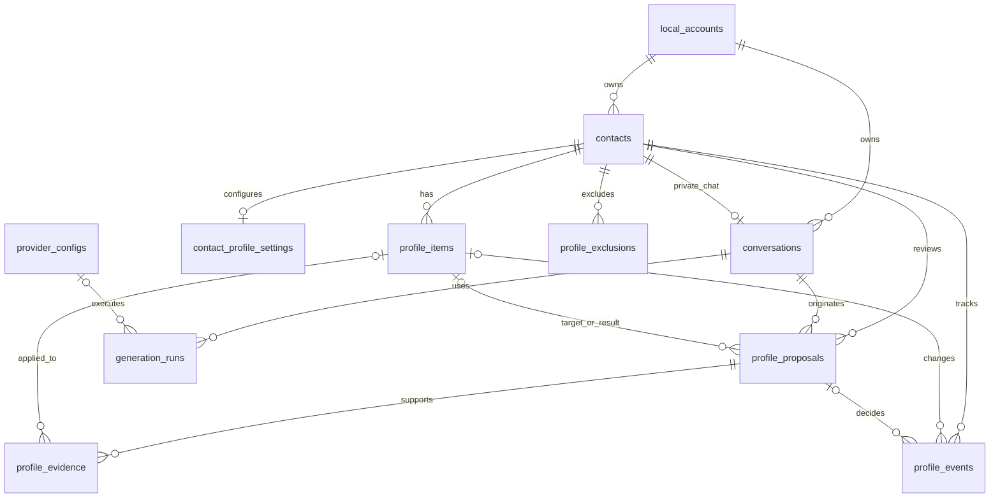

# 微信回复助手数据库设计

版本：v1.0；日期：2026-11-16。以下是应用自有 SQLite 库的设计，不是微信源库结构。本轮不创建生产数据库，不执行微信库迁移。

v0.1 已在 src-tauri/migrations/0001_initial.sql 建立应用库初始迁移并保存示例档案。唯一有意的 DDL 扩展是 local_accounts.source_kind 允许 `demo`，与 greenbubbles 真实来源明确隔离；下方设计 SQL 同步该枚举。微信源库没有被接入或修改。generation_runs 及自动分析检查点等表已预留，但相应完整记录/保留期任务尚未实现，不能视为 MVP 存储能力全部完成。

## 1. 存储范围

本轮语气模板与同步配置复用 `app_settings`：`tone_templates` 保存 id/name/instruction/enabled/baseTone 的数组，`sync_settings` 保存 enabled/intervalSeconds（默认 false/30，允许 5～300 秒）。本次背景开关、背景正文、选中的群消息和草稿只保留在当前编辑会话。示例群聊不创建数据库账号/联系人/会话/画像行；真实群聊的持久化设计尚未实施，不改变当前 conversations.kind 仅 private 的约束。

- **微信源库**：由 GreenBubbles 在用户已有凭据条件下只读访问；不更改表、索引、日志或消息。
- **应用库**：Tauri app data 目录下的 `assistant.sqlite3`，保存账号/联系人映射、沟通档案、提议、证据、变更记录和非敏感配置。
- **内存**：读取到的聊天窗口、模型请求、候选、草稿和本次背景；MVP 不持久化这些正文。
- **Keychain**：模型 API Key；SQLite 只存 Keychain 项的引用。
- **外部受限文件**：已采集的微信数据库凭据；应用只保存 query profile 名与来源路径，不复制凭据值。

MVP 应用库没有数据库级加密，不将“本地保存”描述为“加密保存”。目录 0700、文件及 SQLite 辅助文件限制为当前用户访问。模型分析需要的最少来源摘录会持久化，每条最多 300 字符、每项最多 3 条；用户开启档案分析前须知悉。

## 2. 通用约定

| 项目 | 约定 |
| --- | --- |
| 主键 | TEXT UUID，由应用生成；上游 ID 单独存储，不拿显示名作主键 |
| 时间 | INTEGER UTC epoch ms；NULL 代表未知/不适用，不使用本地时间文本做比较 |
| 布尔 | INTEGER，0/1，并加 CHECK |
| 分类 | 英文枚举存储，界面显示中文 |
| 正文 | TEXT；服务层限制长度，SQL 再做关键约束 |
| JSON | TEXT + json_valid；只存结构化元数据/必要历史，不存凭据 |
| 修订号 | 每项 revision 用于人工编辑检查；联系人 profile_revision 用于分析结果落库检查 |
| 外键 | 每个连接执行 PRAGMA foreign_keys=ON；不能假定默认启用 |
| 事务 | 短事务保存资料、证据、历史和分析检查点；模型请求不能占着写事务 |
| 迁移 | 单调递增版本、内容校验和；已发布迁移不可修改，只加后续迁移 |

SQLite 外键需要按连接开启，父键与外键类型须一致。[SQLite 官方说明](https://www.sqlite.org/foreignkeys.html)

初始化建议设置 `foreign_keys=ON`、`busy_timeout=3000`；MVP 使用单个受控写连接与默认日志模式，不为小规模资料库预先引入复杂连接池。若后续启用 WAL，需一并处理 WAL/SHM 权限、备份和清理。

### 2.1 分类与主题键

| category | 中文 | subject_key 示例 |
| --- | --- | --- |
| relationship | 关系与称呼 | relationship.address |
| communication | 沟通习惯 | communication.emoji |
| preference | 明确偏好 | preference.document_format |
| boundary | 相处边界 | boundary.no_repeated_followup |
| recent | 近期重要事项 | recent.weekend_exhibition |

subject_key 表示具体事项，不是整类资料。已知主题使用受控键；手动自由补充可使用 `custom:<uuid>` 并保留易读 subject_label。模型的新键须经服务层归一化，不能通过随意换键绕过排除或制造重复资料。

## 3. 表清单与关联

| 表 | 用途 |
| --- | --- |
| schema_migrations | 迁移版本与校验和 |
| local_accounts | 明确绑定的本机微信账号/数据源 |
| contacts | 该账号下的联系人稳定映射 |
| conversations | 私聊会话与联系人的绑定 |
| contact_profile_settings | 自动更新开关、资料总版本和成功分析检查点 |
| profile_items | 已确认的资料，含生效范围、来源与锁定状态 |
| profile_proposals | AI 提议，包括待确认观察、冲突和已自动应用的事实 |
| profile_evidence | 提议/资料的必要消息摘录 |
| profile_events | 资料变化与用户核对结果 |
| profile_exclusions | 不再自动记录的具体事项 |
| provider_configs | 模型配置、Keychain 引用与处理范围确认 |
| generation_runs | 不含正文的模型运行元数据，区分回复/档案分析 |
| app_settings | 白名单应用设置 |



账号标识、联系人 ID 和会话 ID 分开保存；备注变更只更新显示信息，不重建档案。应用虽只支持一个活动账号，仍把身份归属记录清楚，避免后续切换账号复用错资料。

## 4. 建表草案

以下单个 SQL 块可用于临时库校验；真正迁移文件在实现阶段再建立。DDL 能保证类型、基本状态及直接关联；目标资料、应用资料、证据所属会话等跨表业务归属还必须由服务层在事务中校验。

```sql
PRAGMA foreign_keys = ON;

CREATE TABLE schema_migrations (
    version INTEGER PRIMARY KEY,
    name TEXT NOT NULL,
    checksum TEXT NOT NULL,
    applied_at_ms INTEGER NOT NULL
);

CREATE TABLE local_accounts (
    id TEXT PRIMARY KEY,
    source_kind TEXT NOT NULL DEFAULT 'greenbubbles'
        CHECK (source_kind IN ('greenbubbles', 'demo')),
    source_account_key TEXT NOT NULL UNIQUE,
    display_name TEXT NOT NULL,
    self_source_id TEXT,
    query_profile_name TEXT NOT NULL UNIQUE,
    source_root TEXT NOT NULL,
    source_version TEXT NOT NULL,
    active INTEGER NOT NULL DEFAULT 0 CHECK (active IN (0, 1)),
    created_at_ms INTEGER NOT NULL,
    updated_at_ms INTEGER NOT NULL
);
CREATE UNIQUE INDEX ux_accounts_one_active
    ON local_accounts(active) WHERE active = 1;

CREATE TABLE contacts (
    id TEXT PRIMARY KEY,
    account_id TEXT NOT NULL REFERENCES local_accounts(id) ON DELETE CASCADE,
    source_peer_id TEXT NOT NULL,
    display_name TEXT NOT NULL,
    remark TEXT,
    nickname TEXT,
    last_seen_at_ms INTEGER,
    created_at_ms INTEGER NOT NULL,
    updated_at_ms INTEGER NOT NULL,
    UNIQUE (account_id, source_peer_id),
    UNIQUE (id, account_id)
);
CREATE INDEX ix_contacts_account_name ON contacts(account_id, display_name);

CREATE TABLE conversations (
    id TEXT PRIMARY KEY,
    account_id TEXT NOT NULL REFERENCES local_accounts(id) ON DELETE CASCADE,
    contact_id TEXT NOT NULL UNIQUE,
    source_conversation_id TEXT NOT NULL,
    kind TEXT NOT NULL DEFAULT 'private' CHECK (kind = 'private'),
    title TEXT NOT NULL,
    last_message_at_ms INTEGER,
    last_read_at_ms INTEGER,
    created_at_ms INTEGER NOT NULL,
    updated_at_ms INTEGER NOT NULL,
    FOREIGN KEY (contact_id, account_id)
        REFERENCES contacts(id, account_id) ON DELETE CASCADE,
    UNIQUE (account_id, source_conversation_id)
);
CREATE INDEX ix_conversations_recent
    ON conversations(account_id, last_message_at_ms DESC);

CREATE TABLE contact_profile_settings (
    contact_id TEXT PRIMARY KEY REFERENCES contacts(id) ON DELETE CASCADE,
    auto_update_enabled INTEGER NOT NULL DEFAULT 0
        CHECK (auto_update_enabled IN (0, 1)),
    profile_revision INTEGER NOT NULL DEFAULT 1 CHECK (profile_revision > 0),
    analysis_checkpoint_json TEXT CHECK (
        analysis_checkpoint_json IS NULL OR json_valid(analysis_checkpoint_json)
    ),
    last_analyzed_at_ms INTEGER,
    last_analysis_status TEXT NOT NULL DEFAULT 'never'
        CHECK (last_analysis_status IN ('never', 'success', 'partial', 'failed')),
    updated_at_ms INTEGER NOT NULL
);

CREATE TABLE profile_items (
    id TEXT PRIMARY KEY,
    contact_id TEXT NOT NULL REFERENCES contacts(id) ON DELETE CASCADE,
    category TEXT NOT NULL CHECK (
        category IN ('relationship', 'communication', 'preference', 'boundary', 'recent')
    ),
    subject_key TEXT NOT NULL,
    subject_label TEXT NOT NULL,
    content TEXT NOT NULL CHECK (length(content) BETWEEN 1 AND 1000),
    source_kind TEXT NOT NULL CHECK (
        source_kind IN ('manual', 'chat_fact', 'user_confirmed')
    ),
    locked INTEGER NOT NULL DEFAULT 1 CHECK (locked IN (0, 1)),
    scope TEXT NOT NULL DEFAULT 'long_term' CHECK (scope IN ('long_term', 'recent')),
    status TEXT NOT NULL DEFAULT 'active' CHECK (status IN ('active', 'archived')),
    valid_from_ms INTEGER NOT NULL,
    expires_at_ms INTEGER,
    revision INTEGER NOT NULL DEFAULT 1 CHECK (revision > 0),
    created_at_ms INTEGER NOT NULL,
    updated_at_ms INTEGER NOT NULL,
    CHECK (expires_at_ms IS NULL OR expires_at_ms > valid_from_ms),
    CHECK (scope <> 'recent' OR expires_at_ms IS NOT NULL),
    CHECK (category <> 'recent' OR scope = 'recent')
);
CREATE UNIQUE INDEX ux_profile_items_active_subject
    ON profile_items(contact_id, subject_key, scope) WHERE status = 'active';
CREATE INDEX ix_profile_items_contact_category
    ON profile_items(contact_id, status, category, updated_at_ms DESC);

CREATE TABLE profile_proposals (
    id TEXT PRIMARY KEY,
    contact_id TEXT NOT NULL REFERENCES contacts(id) ON DELETE CASCADE,
    conversation_id TEXT NOT NULL REFERENCES conversations(id) ON DELETE CASCADE,
    kind TEXT NOT NULL CHECK (kind IN ('fact', 'observation', 'conflict')),
    operation TEXT NOT NULL CHECK (operation IN ('add', 'update')),
    target_item_id TEXT REFERENCES profile_items(id) ON DELETE SET NULL,
    target_revision INTEGER,
    applied_item_id TEXT REFERENCES profile_items(id) ON DELETE CASCADE,
    category TEXT NOT NULL CHECK (
        category IN ('relationship', 'communication', 'preference', 'boundary', 'recent')
    ),
    subject_key TEXT NOT NULL,
    subject_label TEXT NOT NULL,
    proposed_content TEXT NOT NULL CHECK (length(proposed_content) BETWEEN 1 AND 1000),
    scope TEXT NOT NULL DEFAULT 'long_term' CHECK (scope IN ('long_term', 'recent')),
    proposed_expires_at_ms INTEGER,
    status TEXT NOT NULL DEFAULT 'pending'
        CHECK (status IN ('pending', 'applied', 'rejected')),
    decision TEXT CHECK (
        decision IS NULL OR decision IN
            ('auto_apply', 'keep_existing', 'accept', 'accept_as_recent', 'ignore')
    ),
    dedupe_key TEXT NOT NULL,
    extractor_version TEXT NOT NULL,
    created_at_ms INTEGER NOT NULL,
    resolved_at_ms INTEGER,
    UNIQUE (contact_id, dedupe_key),
    CHECK (target_revision IS NULL OR target_revision > 0),
    CHECK (
        (status = 'pending' AND resolved_at_ms IS NULL AND decision IS NULL)
        OR (status <> 'pending' AND resolved_at_ms IS NOT NULL AND decision IS NOT NULL)
    ),
    CHECK (status <> 'applied' OR applied_item_id IS NOT NULL)
);
CREATE INDEX ix_proposals_pending
    ON profile_proposals(contact_id, status, kind, created_at_ms DESC);
CREATE INDEX ix_proposals_conversation ON profile_proposals(conversation_id);
CREATE INDEX ix_proposals_target ON profile_proposals(target_item_id);
CREATE INDEX ix_proposals_applied ON profile_proposals(applied_item_id);

CREATE TABLE profile_evidence (
    id TEXT PRIMARY KEY,
    proposal_id TEXT NOT NULL REFERENCES profile_proposals(id) ON DELETE CASCADE,
    item_id TEXT REFERENCES profile_items(id) ON DELETE CASCADE,
    conversation_id TEXT NOT NULL REFERENCES conversations(id) ON DELETE CASCADE,
    source_message_id TEXT NOT NULL,
    sender_direction TEXT NOT NULL CHECK (sender_direction IN ('self', 'other')),
    message_at_ms INTEGER,
    quote TEXT NOT NULL CHECK (length(quote) BETWEEN 1 AND 300),
    created_at_ms INTEGER NOT NULL,
    UNIQUE (proposal_id, source_message_id)
);
CREATE INDEX ix_evidence_item ON profile_evidence(item_id);
CREATE INDEX ix_evidence_conversation ON profile_evidence(conversation_id);

CREATE TABLE profile_events (
    id TEXT PRIMARY KEY,
    contact_id TEXT NOT NULL REFERENCES contacts(id) ON DELETE CASCADE,
    item_id TEXT REFERENCES profile_items(id) ON DELETE CASCADE,
    proposal_id TEXT REFERENCES profile_proposals(id) ON DELETE CASCADE,
    action TEXT NOT NULL CHECK (action IN (
        'manual_add', 'manual_edit', 'auto_add', 'auto_update', 'lock',
        'unlock', 'accept', 'keep_existing', 'accept_as_recent', 'ignore', 'archive'
    )),
    actor TEXT NOT NULL CHECK (actor IN ('user', 'system')),
    before_json TEXT CHECK (before_json IS NULL OR json_valid(before_json)),
    after_json TEXT CHECK (after_json IS NULL OR json_valid(after_json)),
    created_at_ms INTEGER NOT NULL,
    CHECK (item_id IS NOT NULL OR proposal_id IS NOT NULL)
);
CREATE INDEX ix_events_contact_time ON profile_events(contact_id, created_at_ms DESC);
CREATE INDEX ix_events_item ON profile_events(item_id);
CREATE INDEX ix_events_proposal ON profile_events(proposal_id);

CREATE TABLE profile_exclusions (
    id TEXT PRIMARY KEY,
    contact_id TEXT NOT NULL REFERENCES contacts(id) ON DELETE CASCADE,
    subject_key TEXT NOT NULL,
    subject_label TEXT NOT NULL,
    created_at_ms INTEGER NOT NULL,
    UNIQUE (contact_id, subject_key)
);

CREATE TABLE provider_configs (
    id TEXT PRIMARY KEY,
    name TEXT NOT NULL,
    adapter TEXT NOT NULL DEFAULT 'chat_completions'
        CHECK (adapter = 'chat_completions'),
    base_url TEXT NOT NULL,
    model TEXT NOT NULL,
    keychain_ref TEXT NOT NULL UNIQUE,
    is_default INTEGER NOT NULL DEFAULT 0 CHECK (is_default IN (0, 1)),
    config_revision INTEGER NOT NULL DEFAULT 1 CHECK (config_revision > 0),
    reply_consent_revision INTEGER,
    profile_consent_revision INTEGER,
    consented_at_ms INTEGER,
    created_at_ms INTEGER NOT NULL,
    updated_at_ms INTEGER NOT NULL
);
CREATE UNIQUE INDEX ux_providers_one_default
    ON provider_configs(is_default) WHERE is_default = 1;

CREATE TABLE generation_runs (
    id TEXT PRIMARY KEY,
    conversation_id TEXT NOT NULL REFERENCES conversations(id) ON DELETE CASCADE,
    provider_id TEXT REFERENCES provider_configs(id) ON DELETE SET NULL,
    purpose TEXT NOT NULL CHECK (purpose IN ('reply', 'profile')),
    task TEXT CHECK (task IS NULL OR task IN ('reply', 'rewrite', 'follow_up')),
    context_source TEXT NOT NULL CHECK (context_source IN ('wechat_db', 'manual')),
    context_count INTEGER NOT NULL CHECK (context_count >= 0),
    used_profile INTEGER NOT NULL DEFAULT 0 CHECK (used_profile IN (0, 1)),
    status TEXT NOT NULL CHECK (
        status IN ('running', 'success', 'failed', 'cancelled', 'interrupted')
    ),
    error_code TEXT,
    input_tokens INTEGER CHECK (input_tokens IS NULL OR input_tokens >= 0),
    output_tokens INTEGER CHECK (output_tokens IS NULL OR output_tokens >= 0),
    duration_ms INTEGER CHECK (duration_ms IS NULL OR duration_ms >= 0),
    started_at_ms INTEGER NOT NULL,
    finished_at_ms INTEGER,
    CHECK (
        (status = 'running' AND finished_at_ms IS NULL)
        OR (status <> 'running' AND finished_at_ms IS NOT NULL)
    )
);
CREATE INDEX ix_generation_runs_conversation
    ON generation_runs(conversation_id, started_at_ms DESC);
CREATE INDEX ix_generation_runs_provider ON generation_runs(provider_id);

CREATE TABLE app_settings (
    key TEXT PRIMARY KEY,
    value_json TEXT NOT NULL CHECK (json_valid(value_json)),
    updated_at_ms INTEGER NOT NULL
);
```

## 5. 字段说明

### 5.1 迁移、账号、联系人与会话

| 表 | 字段 | 含义 |
| --- | --- | --- |
| schema_migrations | version/name/checksum/applied_at_ms | 已应用迁移的版本、名称、内容哈希和执行时间 |
| local_accounts | source_account_key | 适配器确认的账号稳定标识；不能用“最近目录”或昵称代替，具体来源在 M0 核实 |
| local_accounts | self_source_id | 本人的稳定源 ID；未知时 NULL，不从昵称猜测 |
| local_accounts | query_profile_name/source_root | 显式查询配置及源库路径，不含密钥值 |
| local_accounts | source_version/active | 最近确认可用的工具版本；单活动账号 |
| contacts | source_peer_id | 上游联系人稳定 ID，联合 account_id 唯一 |
| contacts | display_name/remark/nickname | 展示名、备注、昵称；只用于显示和查找 |
| contacts | last_seen_at_ms | 最近在源会话信息中观察到该联系人时间 |
| conversations | source_conversation_id | 上游会话 ID，与联系人 ID 语义分开 |
| conversations | contact_id/account_id/kind | 属于哪个联系人/账号；MVP 仅 private，一人一私聊 |
| conversations | title/last_message_at_ms/last_read_at_ms | 会话标题、最近消息时间和本应用最近成功读取时间 |

这些表的 id 均为本地 UUID；created_at_ms/updated_at_ms 分别表示本地创建和更新，不能当作微信原文发送时间。

### 5.2 档案设置与正式资料

| 表 | 字段 | 含义 |
| --- | --- | --- |
| contact_profile_settings | auto_update_enabled | 此联系人是否允许自动调用模型更新档案，默认关闭 |
| contact_profile_settings | profile_revision | 资料、提议决策和排除项变动时递增；用于检测分析期间的人工修改 |
| contact_profile_settings | analysis_checkpoint_json | 版本化适配器检查点，只含处理边界/消息 ID，不含正文；不把上游分页 cursor 当全局序列 |
| contact_profile_settings | last_analyzed_at_ms/status | 最近分析执行状态；失败不覆盖成功检查点，partial 不代表全部处理完成 |
| profile_items | category/subject_key/subject_label | 所属分类、具体主题机器键和用户可读主题名 |
| profile_items | content | 当前已确认资料正文，不保存待确认推测 |
| profile_items | source_kind | manual：用户输入；chat_fact：经校验的明确表达；user_confirmed：用户确认的 AI 提议 |
| profile_items | locked | 是否禁止 AI 自动覆盖；人工/用户确认来源无论锁定与否均不静默覆盖 |
| profile_items | scope/status | 长期/近期，以及正常/归档；待确认状态不放这张表 |
| profile_items | valid_from_ms/expires_at_ms | 生效及到期时间；近期项必须有用户已确认的期限 |
| profile_items | revision | 单项资料版本；每次编辑/锁定/归档等修改递增 |

### 5.3 AI 提议、证据、历史与排除

| 表 | 字段 | 含义 |
| --- | --- | --- |
| profile_proposals | kind/operation | 事实、观察、冲突；建议新增还是更新 |
| profile_proposals | target_item_id/target_revision | 对哪个已有条目提出变化，以及分析时看到的条目版本；新增可为空 |
| profile_proposals | applied_item_id | 真正被新增/更新的资料 ID；采纳为近期偏好时可不同于原目标 |
| profile_proposals | proposed_content/scope/proposed_expires_at_ms | 拟采用的正文、范围和期限；期限不明确时保留 pending |
| profile_proposals | status/decision/resolved_at_ms | 是否待核对/已应用/已拒绝，以及具体决定和时间 |
| profile_proposals | dedupe_key | 由版本、原始消息 ID 集合、归一化主题及提议类别生成的哈希；同一证据重试不重复建建议 |
| profile_proposals | extractor_version | 提示词与解析规则版本，便于定位分析行为变化 |
| profile_evidence | proposal_id/item_id | 每条证据先属于提议；应用后同时关联正式资料 |
| profile_evidence | conversation_id/source_message_id | 可重新定位原消息的稳定标识；不跨账号、会话引用 |
| profile_evidence | sender_direction/message_at_ms/quote | 发送方向、发送时间和有限原文摘录；自动事实需来自 other 的明确表达 |
| profile_events | action/actor | 什么操作、由用户还是系统触发 |
| profile_events | before_json/after_json | 该项必要的前后内容与状态；不存整份模型输入或所有档案 |
| profile_exclusions | subject_key/subject_label | 以后不再自动记录的具体主题；保留最少可识别信息，不保留已删除资料正文 |

引用消息后不能直接信任模型结论。写入前核对引文是选定窗口原文的子串、所属会话一致、方向准确，并执行主题排除和人工来源优先规则。

### 5.4 模型配置、运行信息与设置

| 表 | 字段 | 含义 |
| --- | --- | --- |
| provider_configs | adapter/base_url/model | 协议适配器、API 基础地址和模型标识；不得把 Key 放进 URL |
| provider_configs | keychain_ref | macOS Keychain 的 service/account 引用，永不存 Key 值 |
| provider_configs | config_revision | 服务商端点或模型变化时递增；触发处理范围重新确认 |
| provider_configs | reply_consent_revision/profile_consent_revision | 对应处理范围确认的配置版本；只有等于 config_revision 才生效 |
| provider_configs | is_default/consented_at_ms | 唯一默认配置、最近处理范围确认时间 |
| generation_runs | purpose/task/context_source/context_count/used_profile | 哪类模型请求、任务、来源、消息数量、是否参考档案；不含 prompt 或自定义语气正文 |
| generation_runs | status/error_code | 运行中/成功/失败/取消/重启后中断；只存标准错误代码 |
| generation_runs | input_tokens/output_tokens/duration_ms | 可用时保存用量和耗时，不能伪造服务商未返回的 token 统计 |
| generation_runs | started_at_ms/finished_at_ms | 开始和终止时间；复制不等于发送，不在此表记录“已发送” |
| app_settings | key/value_json | 快捷键、默认置顶、窗口位置等白名单设置，不保存本次背景或草稿 |

generation_runs 保留 30 天，启动时清理过期记录；运行中的记录在下次启动标为 interrupted。资料及其历史默认保留到用户删除；已拒绝提议与未关联正式资料的来源摘录保留 30 天，之后删除。排除项独立保留，直到用户解除。

## 6. 索引设计

- 账号、联系人、会话的唯一索引用来防止因重名、改备注和重复读取生成多份映射。
- 会话最近时间索引用于会话列表；联系人 name 索引仅帮助前缀/精确匹配，`LIKE '%内容%'` 不保证使用它。首版联系人规模先测量，不预先引入全文引擎。
- profile_items 的部分唯一索引限制每个具体主题每种 scope 只有一条 active 资料；同一个主题可以同时有长期资料和近期覆盖项。
- 新增同主题近期项时，在同一事务归档此前已到期的 active 近期项，再插入；读取时仍必须按时间过滤，不能依赖后台定时任务完成归档。
- 提议按联系人、状态、类型分页；dedupe_key 唯一约束处理重试去重。
- 证据、历史和提议的外键索引用于资料详情与删除，不给档案正文、历史 JSON 建无用途索引。
- 运行记录按会话和时间查询；清理采用小批量删除，实际批量大小在实现时根据数据量确定。

## 7. 核心读写与事务

### 7.1 读取生成可用档案

```sql
SELECT id, category, subject_key, content, source_kind, scope, revision
FROM profile_items
WHERE contact_id = :contact_id
  AND status = 'active'
  AND valid_from_ms <= :now_ms
  AND (expires_at_ms IS NULL OR expires_at_ms > :now_ms)
ORDER BY category, updated_at_ms DESC;
```

服务层按主题合并：有效近期项优先于同主题长期表达偏好；本次指令优先于默认表达风格；事实与相处边界用于约束/提醒。关闭本次参考档案时，不执行这一步模型装配。pending 提议永远不参与正式资料查询。

### 7.2 人工修改

1. 根据 item_id 读取并确认归属。
2. 以 `WHERE id=:id AND revision=:expected_revision` 修改，revision+1；更新行数为 0 时返回版本冲突。
3. 保存必要前后历史，递增联系人 profile_revision。
4. 同一事务提交；修改正文后 source_kind 设为 manual，保留相关原证据仅用于历史，不把它当新正文的事实依据。

### 7.3 自动事实或用户采纳

1. 网络请求在事务之外执行，返回后校验账号、会话、证据、主题、有效期和资料修订号。
2. 事务中检查排除及人工优先规则，保存/复用提议并执行新增、更新或转待确认。
3. 保存证据与事件，成功应用时设置 applied_item_id、decision 和 resolved_at_ms。
4. 只有本批消息连续处理完成，才保存成功检查点；重复处理通过主题合并和 dedupe_key 去重。
5. 同时递增 profile_revision。资料版本变化则重新核对建议，不盲目重试旧的覆盖操作。

### 7.4 删除与不再记录

- 删除不是归档：用户选择删除资料时，事务内移除该项关联的证据、应用提议及正文历史，并清除引用该项的待处理冲突。不能仅把 profile_items.status 改掉。
- 已采纳成另一个近期条目的提议是独立资料；删除原长期项时，解除原目标引用，保持近期项自己的依据。不在该提议中存已删除原资料的正文副本。
- “以后不再记录此项”先 upsert profile_exclusions，再清理同 subject_key 的当前资料、待确认提议和正文记录；服务层阻止换一种措辞重复加入。
- 清空联系人数据时先停止关联任务，再清除以上内容、运行元数据、检查点和内存，关闭自动更新；保留联系人/会话映射及设置行，profile_revision 递增而不重置，以便拒绝清理前的分析结果。
- 删除 provider 时同步删除 Keychain 项，运行元数据的 provider_id 置空；不把删除凭据当作删除全部个人资料。
- 不承诺操作系统文件系统、备份或 SQLite 空闲页中的取证级擦除；用户级删除的范围是本应用可访问的记录和界面内容。

## 8. 本轮与实现阶段验证

2026-11-16 已对本文 SQL 在内存临时库完成校验：13 张表建表成功，foreign_key_check 无错误；单活动账号、同名联系人分账号隔离、联系人/账号外键、主题唯一约束、近期项期限、提议去重，以及独立近期资料和证据/历史级联关系均通过虚构数据检查。这只验证设计 SQL，不连接微信、不创建正式应用库，也不代表 Rust 仓储或产品清理流程已经实现。

正式实现还须测试：

1. 从空库初始化与从前一版本迁移；迁移校验和不一致时停止。
2. 不同账号同名联系人隔离，跨会话证据拒绝写入。
3. 手动资料不被自动覆盖；长期/近期同主题正确合并和过期。
4. 同消息批次重复分析不重复建项；中断不越过未处理消息。
5. 删除/排除后，历史及证据不残留正文，重新分析不会恢复排除项。
6. 删除联系人、会话、provider 的外键与服务层清理符合预期。
7. 输入预算、摘录长度与 JSON 结构检查；应用文件中不存在任何凭据值。
